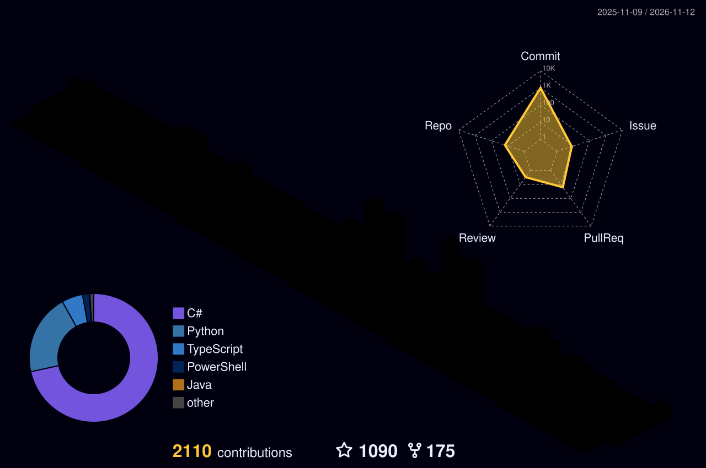

<!--
  Kengwang · GitHub Profile
  Design: Tokyo Night / violet · blue · cyan
  Dynamic assets: capsule-render, typing-svg, shields.io, locally generated stats cards,
  streak-stats, snk, 3D contrib.
  Generated cards, the 3D calendar and snake appear after the single profile workflow runs.
-->

<div align="center">


<a href="https://github.com/kengwang">
  
</a>

<p>
  <a href="https://github.com/kengwang?tab=followers"></a>
  <a href="https://github.com/kengwang"></a>
</p>

**[About](#-about-me)** &nbsp;·&nbsp; **[Projects](#-featured-projects)** &nbsp;·&nbsp; **[Open Source](#-open-source-contributions)** &nbsp;·&nbsp; **[Activity](#-github-in-motion)** &nbsp;·&nbsp; **[Contact](#-connect)**

</div>

## ✦ About me

```csharp
var kengwang = new
{
    Craft = new[] { "C#", ".NET", "WPF", "ASP.NET Core" },
    CuriousAbout = new[] { "Security", "CTF", "Music & Lyrics" },
    Loves = "Open source and building useful things",
};
```

I'm a developer who enjoys **turning ideas into usable software** — from Windows desktop apps to .NET libraries, music-related tools, and security projects.

喜欢写代码，也喜欢折腾音乐与安全。**中文 / English** are both welcome. And yes, PHP still has a place in my heart. 💜

## ⚡ Tech & tools

<div align="center">


<sub>At home with <b>C# · .NET · WPF · ASP.NET Core</b> — and always curious about what comes next.</sub>

</div>

## 🚀 Featured projects

<div align="center">

<a href="https://github.com/HyPlayer/HyPlayer"></a>
<a href="https://github.com/kengwang/BiliDuang"></a>
<a href="https://github.com/kengwang/Depository"></a>
<a href="https://github.com/kengwang/ALRC"></a>

</div>

| Project | A little about it | Highlight |
| :--- | :--- | :---: |
| 🎧 **[HyPlayer](https://github.com/HyPlayer/HyPlayer)** | An open-source music player project. |  |
| 📺 **[BiliDuang](https://github.com/kengwang/BiliDuang)** | Bilibili video downloader with a C# graphical interface. | [](https://github.com/kengwang/BiliDuang/stargazers) |
| 📦 **[Depository](https://github.com/kengwang/Depository)** | Flexible IoC / dependency-injection container for .NET. | [](https://www.nuget.org/packages/Depository/) |
| 🎼 **[ALRC](https://github.com/kengwang/ALRC)** | A lyric format and its creator. |  |
| 🌍 **[EarthQuakeWarning](https://github.com/kengwang/EarthQuakeWarning)** | An unofficial earthquake-warning app built with C# / WPF. |  |

<sub>EarthQuakeWarning is an unofficial experimental project, not a substitute for official emergency alerts.</sub>

## 🤝 Open-source contributions

I enjoy building alongside other developers, too.

| Project | What it is | Community |
| :--- | :--- | :---: |
| 🏁 **[GZ::CTF](https://github.com/GZTimeWalker/GZCTF)** | An open-source CTF platform built with ASP.NET Core. | [](https://github.com/GZTimeWalker/GZCTF) |
| 💬 **[Lagrange.Core](https://github.com/LagrangeDev/Lagrange.Core)** | A C# implementation of the NTQQ protocol. | [](https://github.com/LagrangeDev/Lagrange.Core) |

## 📊 GitHub in motion

<!-- Run Actions > Update GitHub profile visuals once after uploading the workflow. -->

<div align="center">

<a href="https://github.com/kengwang"></a>
<a href="https://github.com/kengwang"></a>


<sub>Statistics and project cards are generated by GitHub Actions and stored in this repository — no public stats-card server required.</sub>

</div>

## 🌌 Contributions, in another dimension

<div align="center">

<!-- Generated with the same Update GitHub profile visuals workflow. -->
<picture>
  <source media="(prefers-color-scheme: dark)" srcset="./profile-3d-contrib/profile-night-rainbow.svg" />
  <source media="(prefers-color-scheme: light)" srcset="./profile-3d-contrib/profile-season-animate.svg" />
  
</picture>

<sub>A 3D view of a year of commits — generated automatically by GitHub Actions.</sub>

</div>

## 🐍 A little commit-powered snake

<div align="center">

<!-- Generated with the same Update GitHub profile visuals workflow. -->
<picture>
  <source media="(prefers-color-scheme: dark)" srcset="./profile/snake/github-contribution-grid-snake-dark.svg" />
  <source media="(prefers-color-scheme: light)" srcset="./profile/snake/github-contribution-grid-snake.svg" />
  
</picture>

</div>

## 💌 Connect

<div align="center">

**Ideas, open-source collaborations, or just saying hi?**

<a href="mailto:github@kengwang.com.cn"></a>
<a href="https://afdian.com/a/kengwang"></a>
<a href="https://www.patreon.com/kengwang"></a>

[GitHub](https://github.com/kengwang) · [Public GPG key](https://github.com/kengwang/kengwang/blob/master/Kengwang_0x9ED4CB8A0CF42B18_public.asc)

*Thanks for visiting. Keep building cool things.* ✨


</div>
